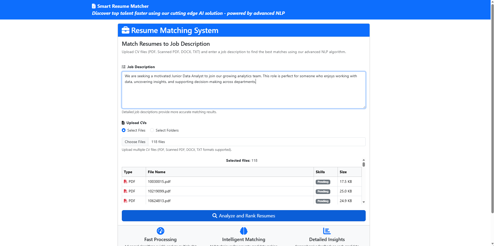
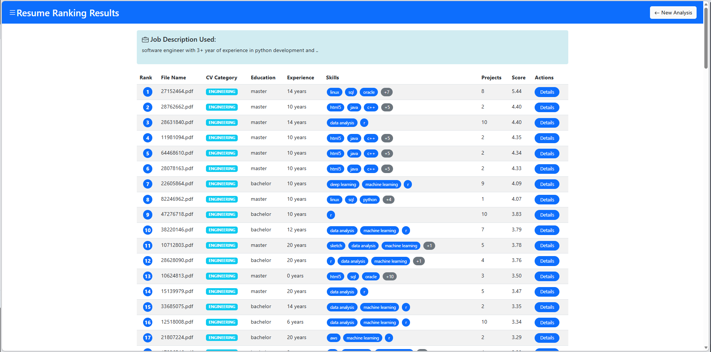

# Intelligent CV Ranker

A Flask web application that ranks CVs against a job description and writes feedback for recruiters and for candidates. It is the ranking application from my bachelor thesis at North South University (NSU), Dhaka.

## Thesis

- Title: Reducing Recruitment Bias: An NLP-Based CV Ranking and Feedback System for Identifying and Mitigating Disparities in Job Matching
- Courses: CSE499A and CSE499B (Senior Design Project I and II), July 2024 to April 2025
- Authors: Md. Amanullah Shah and Rapa
- Supervisor: Dr. Sifat Momen, Department of Electrical and Computer Engineering, NSU
- Full report: [thesis PDF](https://drive.google.com/file/d/15GuyycsH2kLnwtApAi-j91z22vb3OmAR/view?usp=sharing)

This repository holds the web application. Two parts of the thesis are described in the report and are not in this code: the model comparison (classical classifiers against DistilBERT, BERT, RoBERTa, LUKE and LongFormer, with LongFormer best at 89.74% accuracy) and the step that removes names and gender before ranking. The application was built during the thesis; this cleaned-up version was uploaded in March 2026.

## What the application does

1. Reads CVs as PDF (pdfplumber), scanned PDF (Tesseract OCR via pdf2image and OpenCV), DOCX and TXT.
2. Cleans the text with NLTK: tokenisation, stop-word removal and lemmatisation.
3. Extracts features: education level (spaCy noun chunks and fuzzy keyword matching), years of experience (regular expressions), skills (fuzzy matching against a skill list, threshold 85), certifications (keyword patterns) and a project count.
4. Compares each CV with the job description using TF-IDF vectors and cosine similarity.
5. Ranks the CVs by a weighted score:

   ```
   score = 0.15 x education + 0.20 x experience + 0.15 x skills
         + 0.10 x (2 x certifications) + 0.10 x projects
         + 0.30 x (10 x job-description similarity)
   ```

6. Writes feedback from templates: strengths for HR, and missing skills with suggestions for candidates.

## Screenshots

Job description and CV upload:



Ranked results:



## Run it locally

Python 3.10 is recommended (see `runtime.txt`).

```bash
git clone https://github.com/amanullahshah32/intelligent-cv-ranker.git
cd intelligent-cv-ranker
python -m venv .venv
source .venv/bin/activate          # Windows: .venv\Scripts\activate
pip install -r requirements.txt    # includes the spaCy model en_core_web_sm
python app.py
```

Then open http://localhost:5000 (the port can be changed with the `PORT` environment variable).

Scanned PDFs need Tesseract OCR and Poppler. Their paths are set in `_init_ocr_capabilities` in `utils/resume_ranker.py`; without them the app still reads normal PDFs, DOCX and TXT files.

## Data

`data/data/` holds 2,484 sample CVs in 24 job categories from the [Resume Dataset](https://www.kaggle.com/datasets/snehaanbhawal/resume-dataset) on Kaggle (Bhawal, 2021; CV examples from livecareer.com). The thesis used the same dataset.

## Notebook

`notebooks/8.2_transformer_approach.ipynb` is an experiment with DistilBERT embeddings and LIME explanations. The web application does not use it yet.

## Contact

Md. Amanullah Shah, amanullahshah012@gmail.com
